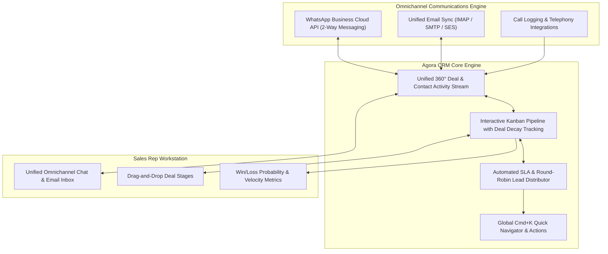

<p align="center">
  
</p>

<p align="center">
  <strong>High-Velocity Conversational Sales CRM with Native WhatsApp & Unified Email Streams</strong>
</p>

<p align="center">
  <a href="https://www.linkedin.com/in/akashjadon"></a>
  <a href="https://github.com/akashjadon04"></a>
  
  
  
</p>

---

## ⚡ Executive Summary

**Agora** (named after the historic Greek marketplace and forum) is a modern, high-velocity conversational sales CRM designed for modern deal-closing teams. It bridges the critical divide in modern sales: uniting **WhatsApp Business API messaging** and **unified two-way email communications** into a single, cohesive deal timeline.

With a lightning-fast keyboard-first interface (`Cmd+K` command palette), automated deal decay monitors, visual Kanban stages, and collaborative team notes, Agora enables sales teams to close deals 3x faster without switching between disparate chat apps and slow legacy CRMs.

---

## 🏛️ Conversational Sales Architecture



---

## 💎 Core Technical Capabilities

| Capability | Specification | Value vs Legacy CRMs |
| :--- | :--- | :--- |
| **Native WhatsApp Integration** | Direct Meta Cloud API integration with media support | Sales reps chat with leads directly from the CRM without personal phone numbers. |
| **Unified 360° Activity Stream** | Real-time timeline of emails, chats, notes, calls, tasks | Zero context switching; every communication is logged to the deal card automatically. |
| **Kanban with Decay Alerts** | Visual deal stages with stale lead indicators | Never let a high-value opportunity go cold due to neglected follow-ups. |
| **Keyboard-First Speed** | Sub-second navigation with `Cmd+K` palette | Complete sales actions, log calls, and update stages without touching the mouse. |
| **Automated Lead Routing** | Round-robin distribution with SLA timers | Inbound leads from web forms or ad campaigns are routed to active reps instantly. |

---

## 🚀 Quick Start (Frappe Stack)

```bash
# Clone the repository
cd /Users/Satoru/.gemini/antigravity/scratch/automation-gems/agora

# Setup backend and install frontend assets
cd frontend && npm install && npm run build
```

---

## 👨‍💻 Developer & Architect

<div align="center">
  <h3>Designed, Built & Maintained by <strong>Akash Jadon</strong></h3>
  <p><em>Autonomous Agent Architect | Distributed Systems Engineer | Platform Specialist</em></p>
  
  <a href="https://www.linkedin.com/in/akashjadon">
    
  </a>
  <a href="https://github.com/akashjadon04">
    
  </a>
</div>

---

## 📜 Sovereign Ownership & License

Decoupled and re-engineered as **Agora Conversational CRM**. Maintained as a private, high-performance technology asset developed by **Akash Jadon**. All legacy telemetry and third-party trackers have been removed.\n